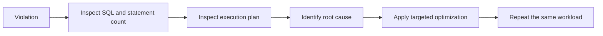
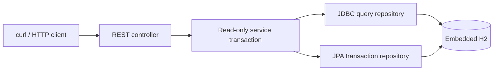
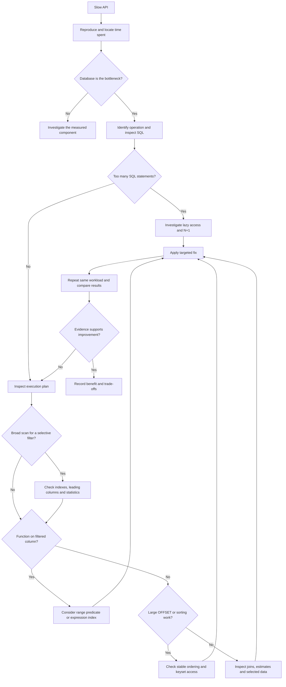
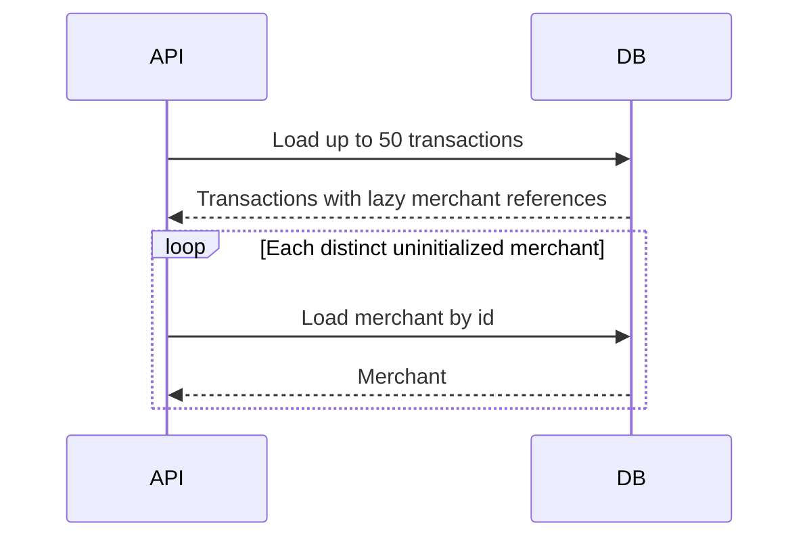
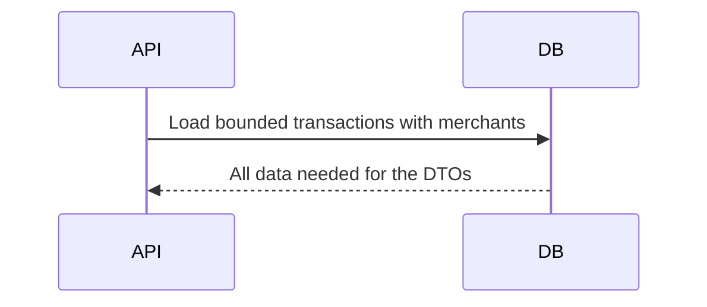

# Query Optimization Showcase

A focused Spring Boot case study demonstrating how to diagnose and optimize slow database queries by comparing intentionally inefficient implementations with targeted solutions.

> **“Our transaction-history API has become slow. How do we determine why and optimize it?”**

This repository answers that question through four causes, four fixes, generated fake data, executed H2 plans, and measured Hibernate SQL counts. The FinTech domain is context for the investigation, not a banking product.

**Two-minute review:** read the comparison below, inspect [the SQL repository](src/main/java/com/example/queryoptimization/repository/TransactionQueries.java) and [the JPA repository](src/main/java/com/example/queryoptimization/repository/TransactionRepository.java), then review [the recorded verification](docs/verification.md). Every case keeps both `violation` and `solution` endpoints.

## What This Repository Demonstrates

| Problem | Violation | Detection | Solution |
|---|---|---|---|
| Missing index | Scan an account's history without a useful secondary index | SQL + `EXPLAIN ANALYZE` | Composite index matching filter and order |
| Non-sargable predicate | Cast an indexed timestamp to a date | Inspect index conditions and scan counts | Half-open timestamp range |
| N+1 | Load transactions, then lazily load merchant names | Hibernate SQL and session-local statement counts | Targeted to-one fetch join |
| Deep pagination | Skip 40,000 rows to return 20 | SQL + execution plan | Seek from a timestamp/id cursor |



## Technology Stack

| Component | Version / purpose |
|---|---|
| Java | **25**; records, time API, `BigDecimal` |
| Spring Boot | **4.1.1** |
| Maven | **3.9.16**, pinned by Maven Wrapper |
| Spring Web MVC | Eight REST endpoints; Boot 4's `spring-boot-starter-webmvc` |
| Spring Data JPA / Hibernate | LAZY relationship and fetch-join comparison; Hibernate **7.4.5.Final** managed by Boot |
| H2 | Embedded, in-memory **2.4.240**, managed by Boot |
| Bean Validation | Account format, page bounds, page size, cursor id |
| Spring JDBC | Explicit SQL for index, predicate, and pagination cases; included transitively by Data JPA |

No Docker, external database, cloud service, frontend, authentication, cache, messaging, CI/CD, or test dependency is required. Maven still prints its standard test lifecycle phases; there is no `src/test/` and no tests to run.

## Architecture



The controller validates inputs and returns records. The service owns transaction boundaries, maps JPA entities inside the transaction, and constructs cursors. Repositories own queries. `spring.jpa.open-in-view=false` prevents entity fetching from leaking into response serialization.

`Transaction.merchant` is `@ManyToOne(fetch = LAZY)`. `account_id` stores the fake account number as a scalar Java field. No account-fetching scenario is being demonstrated. Monetary values are `NUMERIC(19,2)` / `BigDecimal`. Currency and status are Java enums.

`schema.sql` owns schema/index creation; Hibernate validates the mappings. Startup generates the data with JDBC batches, avoiding 50,000 managed entities. The optional diagnostics runner executes the analysis SQL after the seeding transaction commits.

## Dataset

| Data | Count |
|---|---:|
| Accounts | 50 |
| Merchants | 100 |
| Logical transactions | 50,000 |
| Additional unindexed transaction copies | 50,000 |
| Transactions per account | 1,000 |

All values are synthetic: `ACC-00001`, `Demo Customer 1`, and names such as `Demo Market 1`. No real financial or customer data is used.

The seed is arithmetic, not random. Dates span **2026-01-01T00:00:00 through 2026-12-31T21:27:27**. Five consecutive transactions share each timestamp, deliberately exercising cursor tie-breaking. Accounts are interleaved, merchants repeat across the history, and `PENDING` / `COMPLETED` / `FAILED` and `USD` / `EUR` / `GBP` all occur. The date `2026-08-15` has **140 transactions**.

Timestamps use `LocalDateTime` and SQL `TIMESTAMP(6)`, interpreted by this demo as **UTC by convention**. The API date means a UTC calendar day; timestamps have no offset suffix. In production, choose and document timestamp storage and business timezone semantics explicitly. A local business day may need conversion to an instant range and may span 23 or 25 hours across daylight-saving changes.

The whole database resets when the application process stops. Wait for the `Seeded 50 fake accounts...` line before calling endpoints; in diagnostics mode, also wait for all six plan reports. Tomcat's `Started` line precedes application-runner completion.

### Why two transaction tables?

Indexes are schema state, so dropping/creating one while concurrent requests run would make a before/after comparison inconsistent. `transactions` and `transactions_unindexed` contain identical rows and ids. The latter has only its primary key and deliberately no foreign keys: H2 can create supporting indexes automatically for foreign keys, accidentally weakening a missing-index demonstration.

The indexed table retains the merchant foreign key required by the JPA relationship. Neither transaction table declares an account foreign key: H2 otherwise creates a competing account-only supporting index for this schema, hiding the composite index's role. The deterministic initializer supplies only valid fake account numbers. This is a documented demonstration choice, not advice to drop production referential integrity for performance.

**This repository is intentionally small and educational. Violation and solution implementations coexist so the difference can be inspected directly. A production application would not normally keep deliberately inefficient implementations or duplicate demonstration tables.**

## How to Run

From the `query-optimization-showcase` directory, with JDK 25 installed:

```bash
java -version
./mvnw -version
./mvnw clean package
./mvnw spring-boot:run
```

The first two commands must report Java **25** and Apache Maven **3.9.16**. A globally installed Maven is not necessary. The wrapper's first run needs internet access to download Maven and dependencies; subsequent runs can reuse the local cache.

The API binds to **127.0.0.1:8080**. Stop with Ctrl+C. To inspect SQL, bind parameters, statistics, and six real execution plans, stop the normal process and run:

```bash
./mvnw spring-boot:run -Dspring-boot.run.profiles=diagnostics
```

Both startup commands and the build were executed successfully during verification. The executable JAR is also available after building:

```bash
java -jar target/query-optimization-showcase-1.0.0.jar
```

Windows equivalents, from Command Prompt:

```bat
java -version
mvnw.cmd -version
mvnw.cmd clean package
mvnw.cmd spring-boot:run
mvnw.cmd spring-boot:run -Dspring-boot.run.profiles=diagnostics
```

Windows execution was not verified in the Linux verification environment. In PowerShell, use `./mvnw.cmd` and `curl.exe`.

## Endpoints and curl Examples

The first three cases return arrays of `TransactionResponse`. Both pagination endpoints return `{ "items": [...], "nextCursor": {...} }`. All queries select the same transaction response fields, including merchant name. Controllers never serialize JPA entities.

Account history defaults to 50 rows, with `size` in **1..100**. Pagination defaults to 20 rows, also capped at 100; `page` is zero-based and bounded to **0..1,000,000**. Date searches return all rows for that day. Correctly formatted unknown accounts and empty dates return empty arrays. Invalid parameters and incomplete cursor pairs return HTTP 400 using Spring's problem-details handling.

### Missing index

```bash
curl -fsS "http://localhost:8080/api/query-optimization/missing-index/violation?accountId=ACC-00001&size=50"
curl -fsS "http://localhost:8080/api/query-optimization/missing-index/solution?accountId=ACC-00001&size=50"
```

### Non-sargable predicate

```bash
curl -fsS "http://localhost:8080/api/query-optimization/non-sargable/violation?date=2026-08-15"
curl -fsS "http://localhost:8080/api/query-optimization/non-sargable/solution?date=2026-08-15"
```

### N+1

```bash
curl -fsS "http://localhost:8080/api/query-optimization/n-plus-one/violation?accountId=ACC-00001&size=50"
curl -fsS "http://localhost:8080/api/query-optimization/n-plus-one/solution?accountId=ACC-00001&size=50"
```

### OFFSET and cursor pagination

```bash
curl -fsS "http://localhost:8080/api/query-optimization/pagination/violation?page=2000&size=20"
curl -fsS "http://localhost:8080/api/query-optimization/pagination/solution?size=20"
```

The first cursor page returns ids `50000` through `49981`. Its next cursor is:

```json
{
  "createdAt": "2026-12-31T18:49:48",
  "id": 49981
}
```

Pass **both** fields to continue:

```bash
curl -fsS "http://localhost:8080/api/query-optimization/pagination/solution?size=20&cursorCreatedAt=2026-12-31T18:49:48&cursorId=49981"
```

For a like-for-like deep-page comparison, this known cursor represents the row immediately before offset 40,000 in the immutable seed:

```bash
curl -fsS "http://localhost:8080/api/query-optimization/pagination/solution?size=20&cursorCreatedAt=2026-03-14T23:40:00&cursorId=10001"
```

It returns the same 20 items as `page=2000&size=20`, starting at id `10000`. In a real client, obtain a cursor from the previous response rather than manufacturing one from a page number.

Pagination fetches `size + 1` rows to establish whether a next page exists, returns at most `size`, and constructs the next cursor from the last **returned** item. `nextCursor` is `null` for a terminal/empty page. The OFFSET response also exposes this cursor, letting a client switch to sequential navigation. Neither version runs an unnecessary total-count query.

## Problem Investigation Process

**Symptom:** the HTTP response is slow. **Cause:** the specific operation producing that delay. **Fix:** a change aimed at that cause. **Verification:** evidence that the same operation now does less work without changing results.

An immediate “add Redis” suggestion skips the diagnosis. First establish whether time is spent in the database at all.

1. Reproduce the slow endpoint with the same inputs and representative data.
2. Measure where time is spent: SQL, connection acquisition, application work, and response transfer.
3. Identify the service/repository operation on the request path.
4. Inspect the actual SQL and bound values, not just the JPQL or method name.
5. Count SQL statements for the entire operation, including DTO mapping.
6. Execute `EXPLAIN`; use `EXPLAIN ANALYZE` when executing the query is appropriate.
7. Inspect the access paths and sort work, including inner/outer join behavior.
8. Inspect predicates: equality, ranges, casts, functions, and implicit conversions.
9. Check available indexes and their leading columns, direction, and coverage.
10. Check cardinality, selectivity, and the number of candidate rows.
11. Check pagination strategy, requested depth, and whether LIMIT can stop work early.
12. Check ORM fetching, lazy access, and persistence-context reuse.
13. Form a specific hypothesis about the bottleneck.
14. Apply one targeted optimization.
15. Execute the same workload again with the same response shape.
16. Compare plans, scan counts, SQL counts, and reliable latency measurements.
17. Verify result equivalence and confirm the actual bottleneck was reduced.

**Never start randomly adding indexes or rewriting code before identifying the actual bottleneck.** An index existing on disk is not evidence that the query uses it effectively.



## Diagnostics and Execution Plans

Normal mode disables Hibernate statistics and noisy SQL logging. `diagnostics` enables:

- `org.hibernate.SQL=DEBUG`: SQL generated by Hibernate.
- `org.hibernate.orm.jdbc.bind=TRACE`: Hibernate bind values for the fake dataset.
- `org.springframework.jdbc.core.JdbcTemplate=DEBUG`: executed JDBC query templates.
- `hibernate.generate_statistics=true`: Hibernate's normal statistics support.
- A session-local `SessionEventListener`: prepared-statement counts around the N+1 operation, including lazy loads during DTO mapping.
- `AnalysisPlanReporter`: executes the six checked-in `EXPLAIN ANALYZE` scripts after seeding and logs the returned plans.

The local counter avoids subtracting global statistics while other requests might be running. It counts Hibernate prepared statements for these read-only operations; it is not a generic JDBC/batching monitor. Each HTTP call gets a fresh persistence context. No second-level cache or batch fetching is configured, preserving the violation.

`EXPLAIN ANALYZE` actually runs the SELECT. H2's `scanCount` is an engine-specific counter; it may include end-of-range probes and repeated accesses from a join. It is **not** a duration, a PostgreSQL “rows removed” metric, or necessarily the number of distinct rows returned. Read each counter in the context of its table/operator.

The scripts use the exact JDBC query shapes and representative literal parameters. Pagination scripts fetch 21 candidates for 20 response items, matching the lookahead. Inspect [all scripts](src/main/resources/sql/analysis/) or the [captured final plans](docs/verification.md). They execute automatically inside the same JVM/database as the API. A separate connection to `jdbc:h2:mem:queryoptimization` in another JVM would create a different empty database; it cannot inspect this process's data.

## Case 1 — Missing Database Index

### Problem

An account-history endpoint grows slower as the transaction table grows, despite returning only the latest 50 transactions for one account.

### Violation

`findTransactionsWithoutAccountIndex()` queries the deliberately unindexed copy. The central access pattern is:

```sql
SELECT id, account_id, merchant_id, amount, currency, status, created_at, description
FROM transactions_unindexed
WHERE account_id = ?
ORDER BY account_id, created_at DESC, id DESC
LIMIT 50;
```

The executable repository query also joins merchants to return the same DTO as the solution. `account_id` is constant under the equality filter; spelling it out in ORDER BY preserves the response order while helping H2 recognize the composite index's ordering. The id primary key cannot locate rows by account number or provide the requested time order.

### Why It Is Slow

Without a useful leading account key, the database scans transactions, evaluates each account predicate, and orders the matches before limiting the result. Returning a small response does not imply reading a small amount of data.

### How We Detected It

1. Reproduce `missing-index/violation?accountId=ACC-00001&size=50`.
2. Locate `missingIndexViolation()` and its repository call.
3. Inspect the executed SQL in diagnostics mode.
4. Run `01-missing-index-violation.sql` and inspect the transaction access path.
5. Inspect `schema.sql`: the copy only has an id primary key.
6. Identify the filter `account_id` and ordering `created_at DESC, id DESC`.

### Execution Plan / Query Behavior

The final H2 evidence is recorded in [verification](docs/verification.md). The violation reports `TRANSACTIONS_UNINDEXED.tableScan`. The solution reports the account/time composite index. The measured transaction `scanCount` changes from **50,001 to 50** and the solution reports `index sorted`. Merchant lookup uses the same primary-key join strategy in both queries.

In PostgreSQL, this kind of issue may appear as a sequential scan plus sorting versus an index scan. Those are production analogies, not plans collected from PostgreSQL here.

### Root Cause

The missing secondary index does not match the account filter and time ordering. The problem is the table access path, not controller code.

### Solution

`findTransactionsWithAccountIndex()` applies the same query to `transactions`, which has:

```sql
CREATE INDEX idx_transactions_account_created_at
    ON transactions(account_id, created_at DESC, id DESC);
```

### Why the Solution Works

`account_id` comes first because the query selects **one account by equality**. That account's entries form a contiguous index range. Within that range, `created_at DESC` provides newest-first order; `id DESC` breaks timestamp ties. The planner can avoid checking unrelated accounts and, when it recognizes the order, stop after enough rows.

An index starting with `created_at` primarily organizes all accounts by time. Finding one account could then require checking many unrelated entries. `(account_id, created_at, id)` is designed for this specific access pattern, not because the account column should always lead every index.

### Before vs After

| Characteristic | Violation | Solution |
|---|---|---|
| Schema | Primary key only | Account/time/id composite index |
| Transaction access | Full table scan | Matching account index range |
| Ordering support | No useful ordered account path | Ordered entries within one account |
| Business result | Latest 50 transactions | Identical latest 50 transactions |

### Trade-Offs

Indexes consume storage and cache space. INSERT adds entries; UPDATE of indexed columns moves/rewrites entries; DELETE removes entries. All require maintenance and can add locking, logging, and write amplification. An index on a low-selectivity field such as a three-value status may still require reading a large share of the table. Indexing every column wastes resources and does not guarantee a good composite access path. A production change would add an index to the existing table through an appropriate migration, not duplicate it.

## Case 2 — Non-Sargable Predicate

### Problem

A daily transaction report has an index on the timestamp, but filtering by date still examines most transaction rows.

### Violation

`findTransactionsWithNonSargablePredicate()` uses:

```sql
WHERE CAST(t.created_at AS DATE) = ?
```

Both versions query the **same indexed table**, so the comparison isolates the predicate rather than index availability.

### Why It Is Slow

The query asks the database to transform the timestamp before comparing it. A normal B-tree stores timestamp values, not necessarily their transformed dates. Without an optimizer rewrite or a compatible expression index, the function does not expose a directly seekable timestamp range.

### How We Detected It

Reproduce both endpoints for `2026-08-15`, inspect the generated JDBC templates, compare the `02-non-sargable-*` plans, and check that `idx_transactions_created_at_id` exists. Look for a date range in the **index conditions**, not simply any index name in the plan.

### Execution Plan / Query Behavior

In the observed H2 violation, the optimizer starts with merchants and repeatedly traverses a merchant foreign-key index over transactions. The cast remains a filter, with no timestamp range condition. In the solution, the plan uses `IDX_TRANSACTIONS_CREATED_AT_ID` with explicit lower/upper timestamp bounds and reports `index sorted`. Both return the same **140 rows**, in the same order.

This is an important distinction: a plan containing an index can still do broadly inefficient work. The transaction `scanCount` changes from **50,100 to 141**. The full counters are documented in [verification](docs/verification.md).

### Root Cause

The cast hides the timestamp search bounds from the ordinary timestamp index in this query/engine combination.

### Solution

`findTransactionsWithSargablePredicate()` computes day boundaries and uses:

```sql
WHERE t.created_at >= TIMESTAMP '2026-08-15 00:00:00'
  AND t.created_at <  TIMESTAMP '2026-08-16 00:00:00'
```

### Why the Solution Works

The column remains unchanged, so the database can seek directly into the index's timestamp range. The half-open interval includes midnight on the requested day and excludes midnight on the next. It avoids fragile `23:59:59.999...` end-of-day precision assumptions.

### Before vs After

| Characteristic | Violation | Solution |
|---|---|---|
| Predicate | `CAST(created_at AS DATE) = date` | `created_at >= start AND created_at < end` |
| Timestamp index bounds | Not exposed by this cast query | Explicit range conditions |
| Returned data | 140 daily transactions | Same 140 daily transactions |
| Sort | Plan does not report index ordering | H2 reports `index sorted` |

### Trade-Offs

Functions on indexed columns are **not automatically bad** in every engine or query. Optimizers can rewrite expressions, and expression/generated-column indexes may support a required function directly. Broad date ranges may still favor a scan. Verify the plan and business timezone semantics; do not blindly rewrite predicates without preserving their meaning.

## Case 3 — N+1 Query Problem

### Problem

Transaction history makes many database calls even though each merchant lookup is a fast primary-key query.

### Violation

`findTransactionsWithNPlusOne()` loads the bounded transaction list:

```java
@Query("""
        select t from Transaction t
        where t.accountId = :accountId
        order by t.createdAt desc, t.id desc
        """)
List<Transaction> findTransactionsWithNPlusOne(String accountId, Pageable limit);
```

DTO mapping then calls `transaction.getMerchant().getName()`. `merchant` is LAZY and was not loaded by the initial query.

### Why It Is Slow

The initial query is followed by merchant SELECTs as uninitialized merchant proxies are accessed. A persistence context can reuse an already-loaded merchant, so the general count is **one transaction SELECT plus one SELECT per distinct uninitialized merchant**, not necessarily one for every transaction.

**N+1 is not primarily about one SQL statement being expensive. It is about issuing far too many SQL statements to perform one business operation.** Network latency, query preparation, and repeated database work accumulate.

### How We Detected It

Run the two N+1 curl examples in diagnostics mode. Read the first transaction SELECT, the repeated `WHERE merchant.id=?` SELECTs, and the `N+1 violation/solution` session-count lines. Count through DTO mapping, not just the repository call.

### Execution Plan / Query Behavior

For `ACC-00001&size=50`, the seed supplies 50 distinct merchants in the latest 50 transactions. Actual diagnostic output:

```text
N+1 violation: 50 items, 51 prepared SQL statements in this Hibernate session
N+1 solution: 50 items, 1 prepared SQL statements in this Hibernate session
```

For `size=100`, there are 100 distinct merchants. For other datasets or repeated merchants, the count can be lower. These figures describe this measured workload, not a universal N+1 formula. The two endpoints return identical DTOs.



### Root Cause

The operation needs merchant names, but its query fetches only transactions. Lazy access during DTO mapping introduces additional round trips.

### Solution

`findTransactionsWithMerchantFetch()` applies a targeted fetch join:

```java
@Query("""
        select t from Transaction t
        join fetch t.merchant
        where t.accountId = :accountId
        order by t.createdAt desc, t.id desc
        """)
List<Transaction> findTransactionsWithMerchantFetch(String accountId, Pageable limit);
```

The relationship remains LAZY globally.

### Why the Solution Works

One SELECT loads both transactions and their required to-one merchant data. The DTO mapper sees initialized merchants and issues no follow-up queries. The database performs the join inside one operation.



### Before vs After

| Characteristic | Violation | Solution |
|---|---|---|
| Fetching | Transactions, then lazy merchant SELECTs | Targeted `join fetch t.merchant` |
| Measured SQL count for 50 rows | 51 | 1 |
| Relationship default | LAZY | Still LAZY |
| DTO information | Transaction + merchant name | Identical information |

### Trade-Offs

A fetch join loads complete merchant entities and repeats merchant columns on the wire. A DTO projection can select fewer columns if only a name is needed. An entity graph expresses the fetch requirements separately from the JPQL. Batch fetching can reduce trips when joins/projections do not suit the access pattern. Only the fetch join is implemented for this case.

`FetchType.EAGER` is not a universal fix: it changes every access path, can over-fetch unused data, and does not guarantee one joined SQL statement. To-one joins work with this query's limit because each transaction has one merchant. Paging a to-many fetch join can duplicate root rows or trigger in-memory pagination; that requires a different design.

## Case 4 — Deep OFFSET Pagination

### Problem

The first transaction page looks reasonable, but page 2000 becomes expensive as the ordered history grows.

### Violation

`findTransactionsWithOffsetPagination()` uses the following inner transaction query:

```sql
SELECT id, account_id, merchant_id, amount, currency, status, created_at, description
FROM transactions
ORDER BY created_at DESC, id DESC
LIMIT 21 OFFSET 40000;
```

The 21st row establishes whether another page exists; only 20 are returned.

### Why It Is Slow

Even with an ordering index, OFFSET requires locating and skipping the preceding 40,000 entries before returning the next batch. Without an appropriate order path, additional scan/sort work may be required as well. LIMIT cannot make skipped rows disappear from the work.

### How We Detected It

Inspect the deep-page SQL and `03-pagination-violation.sql`. Compare it with the keyset script at the **same logical page boundary**, using cursor `(2026-03-14T23:40:00, 10001)`. Compare the transaction operator's scan count and verify returned ids, not just the HTTP status.

### Execution Plan / Query Behavior

Both versions use `(created_at DESC, id DESC)` and the **same limited derived-table shape**: select/limit transaction candidates, then join merchants and explicitly restore the outer ordering. This avoids letting H2 choose a merchant-first join over all transactions before limiting. It does not remove OFFSET's skip cost; the violation still skips 40,000 entries.

The final H2 plans show the work in the inner transaction index operation, while the outer join handles only 21 candidates. The inner transaction index `scanCount` changes from **40,021 to 26**. See [the full plans and counts](docs/verification.md). Both deep-page responses contain the same ids `10000` through `9981` and the same next cursor.

### Root Cause

The query identifies the desired position by counting preceding rows rather than seeking from known ordering values.

### Solution

`findTransactionsWithKeysetPagination()` uses:

```sql
WHERE created_at <= :cursorCreatedAt
  AND (created_at < :cursorCreatedAt
       OR (created_at = :cursorCreatedAt AND id < :cursorId))
ORDER BY created_at DESC, id DESC
LIMIT :sizePlusOne;
```

The first `<=` is logically redundant but intentional: it exposes a simple upper timestamp bound to H2's optimizer. The second condition preserves the precise two-column cursor ordering. Both are parameterized.

### Why the Solution Works

The timestamp bound lets the database seek into an ordered index near the cursor rather than traverse from the newest entry. For equal timestamps, `id < cursorId` chooses only rows after the cursor in descending id order. Id is unique, making the order total and stable. A timestamp-only cursor could skip rows that share the boundary timestamp.

The implementation fetches one extra row and returns the cursor from the last included item. It never advances the cursor past the lookahead row. Seven-item pages were also checked so a boundary falls **inside** a five-row timestamp group.

### Before vs After

| Characteristic | Violation | Solution |
|---|---|---|
| Position | Zero-based page × size | Last returned timestamp + id |
| Deep-page work | Locate and skip a large prefix | Seek at a timestamp bound, handle ties |
| Ordering | Timestamp + id descending | Same ordering |
| Selected response rows | 20 | Same 20 at the comparison boundary |
| Total count query | None | None |

### Trade-Offs

Keyset is useful for feeds, transaction histories, audit logs, and infinite scrolling. It requires a stable order and a preceding cursor; it cannot directly jump to page 37. This small implementation supports forward navigation only; backward navigation needs reversed comparisons/order. OFFSET remains useful for arbitrary page access and modest datasets.

Stable ordering does not create a snapshot across separate requests. Inserts ahead of the cursor do not shift the next position as OFFSET would, but deletions or edits to ordering fields can still affect navigation. Production histories should usually have immutable ordering keys, and snapshot requirements need their own design.

A very large number of rows sharing one timestamp can still increase work for this readable OR-based predicate. Different engines may use tuple comparisons or different index strategies. Check the actual plan before claiming constant-time paging.

## Actual Measurements and Before/After Summary

The [verification record](docs/verification.md) contains the actual final H2 plans and measured query counts, along with version/build/runtime checks. No millisecond speedup or throughput benchmark is claimed.

| Scenario | Before | After |
|---|---|---|
| Account history | Table scan; `scanCount=50001` | Composite index; `scanCount=50` |
| Date search | Cast filter; transaction `scanCount=50100` | Timestamp range; `scanCount=141` |
| Merchant lookup | 51 prepared SQL statements for the measured 50 rows | 1 fetch-join statement |
| Deep page | OFFSET 40000; transaction `scanCount=40021` | Cursor seek and tie-break; `scanCount=26` |

Timings vary by hardware, JVM warm-up, data distribution, database engine, and cache state. The important observation is the change in query strategy/execution plan and SQL round trips. Diagnostic logging itself adds overhead, so it is not a latency benchmark configuration.

## Query Optimization Mental Model

Query optimization usually reduces one or more of:

- Rows scanned before finding the matches.
- Rows sorted before returning a small result.
- Data transferred by selecting only required values.
- SQL round trips per business operation.
- Random lookups and unnecessary joins.
- Work required before LIMIT can be applied.

Optimization is not synonymous with “add an index.” The correct intervention depends on where the work occurs. A fast indexed merchant query repeated 50 times needs a fetch strategy; an indexed timestamp hidden behind a cast needs predicate analysis; an indexed ordered query with a deep OFFSET needs a position strategy.

## Practical Index Design

**Cardinality** is the number of distinct values; **selectivity** describes how small a fraction of rows a predicate matches. Here, one account selects 1,000 of 50,000 transactions (2%). A status with only three values may select roughly a third of the table, so a standalone status index need not help.

Composite index order follows access patterns. Equality on `account_id` narrows the range first; `created_at` organizes that account's history; unique `id` resolves ties. Putting the time column first serves a different access pattern. The global timestamp/id index serves daily ranges and global ordered pagination instead of account-specific history.

Filter columns and sort columns must be considered together. Check that the selected index supports both the predicate bounds and the requested ordering; the database may choose another index or a scan based on estimates and selected columns. This showcase deliberately does not create a large covering index containing merchant names, amounts, and descriptions. Extra index width also costs memory, storage, and writes.

Measure usage and write overhead before retaining an index. INSERT, DELETE, and indexed-column UPDATE costs are part of the design, not afterthoughts.

## Sargability

**SARGable means Search ARGument able** — a predicate that allows the database to efficiently use an available index to locate matching rows.

```sql
-- Requires transforming column values in this demo's ordinary-index access path:
WHERE CAST(created_at AS DATE) = ?

-- Exposes search bounds on the stored values:
WHERE created_at >= ? AND created_at < ?
```

Sargability is a property of a predicate relative to available indexes and optimizer capabilities. Compatible expression indexes and optimizer rewrites are valid alternatives when appropriate. An “index scan” label alone does not prove selective access; inspect bounds, actual work, and results.

## ORM Query Optimization

Database performance problems can originate from ORM behavior even when every individual query is fast. JPA annotations describe mappings/fetch intentions; they do not substitute for inspecting the SQL Hibernate actually emits. Count statements over the full business operation, including accessing relationships while mapping response fields.

Use a fetch join or entity graph for a known entity-fetch requirement, a projection for a focused read model, or batching where collecting related entities fits the access pattern. Keep transaction scope intentional. This project maps responses before the transaction ends, disables Open Session in View, and implements one targeted fetch-join solution without changing all associations to EAGER.

## Pagination Comparison

| Property | OFFSET | Keyset |
|---|---|---|
| Simple implementation | Excellent | Moderate |
| Jump to arbitrary page | Yes | No |
| Deep-page efficiency | Can degrade with skipped rows | Usually stable with a matching seek path |
| Stable sort required | Recommended for general use; used here | Required |
| Common use | Admin tables, modest datasets | Feeds/history APIs |
| Cursor/state | Page number | Ordering values from previous page |
| Concurrent inserts ahead of position | Can shift page boundaries | Usually do not shift the cursor boundary |

Neither strategy is universally superior. Choose according to client navigation requirements and observed database work.

## How I Would Answer This in an Interview

> I would reproduce the slow endpoint and first establish whether the database call is the bottleneck. Then I would inspect the executed SQL, bound values, statement count, and execution plan. I would check selectivity, rows scanned, sorting, index column order, ORM fetching, and pagination depth. The root cause determines the change: an appropriate index, a range predicate, a targeted fetch join or projection, or cursor pagination. I would preserve the response semantics, repeat the same workload, compare plans and query counts, and verify that I reduced the actual bottleneck. I would also assess the write, storage, and navigation trade-offs before deploying the change.

## Common Query Optimization Mistakes

- Adding indexes without reading the execution plan.
- Indexing every column instead of designing for actual filter/order patterns.
- Ignoring storage and write/index-maintenance costs.
- Selecting all columns when the response needs only a few.
- Applying functions to filtered indexed columns without checking expression-index/rewrite support.
- Treating EAGER fetching as a universal N+1 fix.
- Ignoring SQL emitted by the ORM or stopping the count before DTO mapping.
- Benchmarking tiny datasets or assuming a low response row count means little scan work.
- Trusting one local timing measurement or measuring with verbose logging enabled.
- Using a huge OFFSET without considering seek access and client requirements.
- Optimizing before reproducing and locating the problem.
- Assuming slow database behavior automatically requires caching.
- Equating an index name in a plan with an efficient search range.
- Comparing two implementations that return different data or different logical pages.

## Production Considerations

H2 makes this repository portable; it does not model PostgreSQL/MySQL internals, network latency, production concurrency, or every planner decision. Only H2 was measured here. In a production investigation, also consider:

- PostgreSQL/MySQL execution plans, actual row estimates, buffers/I/O, and slow-query logs.
- APM spans, database metrics, connection-pool wait/occupancy metrics, and query latency percentiles.
- Production-like cardinality/skew, parameters, statistics/ANALYZE, and index usage statistics.
- Locks, long transactions, competing workloads, stale plans, and write amplification.
- Vacuum/visibility/bloat where applicable, especially in PostgreSQL.
- Safe index deployment and migrations, including database-specific online/concurrent options.

PostgreSQL commonly exposes sequential/index/bitmap scans and explicit sort nodes; H2 exposes its own index comments and `scanCount`. Do not copy H2 numbers into a production capacity claim. No production monitoring or deployment tools are implemented.

## Where to Look

All Java paths below are relative to `src/main/java/com/example/queryoptimization/`.

| Concept | Violation | Solution |
|---|---|---|
| Missing index | `repository/TransactionQueries.java` → `findTransactionsWithoutAccountIndex()` | Same file → `findTransactionsWithAccountIndex()`; index in `src/main/resources/schema.sql` |
| Sargability | `repository/TransactionQueries.java` → `findTransactionsWithNonSargablePredicate()` | Same file → `findTransactionsWithSargablePredicate()` |
| N+1 | `repository/TransactionRepository.java` → `findTransactionsWithNPlusOne()` | Same file → `findTransactionsWithMerchantFetch()` |
| Pagination | `repository/TransactionQueries.java` → `findTransactionsWithOffsetPagination()` | Same file → `findTransactionsWithKeysetPagination()` |
| DTO mapping and counts | `service/QueryOptimizationService.java` → `merchantHistory()` | Mapping and request-local counter cover both N+1 implementations |
| HTTP contract | `controller/QueryOptimizationController.java` | Eight explicit comparison endpoints |
| Data distribution | `bootstrap/DemoDataInitializer.java` | Batched deterministic initialization |
| Plans | `src/main/resources/sql/analysis/*-violation.sql` | `src/main/resources/sql/analysis/*-solution.sql` |
| Diagnostic configuration | `src/main/resources/application-diagnostics.yml` | `config/AnalysisPlanReporter.java` |
| Recorded evidence | [docs/verification.md](docs/verification.md) | Full final H2 plans, SQL counts, and manual checks |

Repository shape:

```text
query-optimization-showcase/
├── .gitignore
├── .mvn/wrapper/maven-wrapper.properties
├── mvnw / mvnw.cmd
├── pom.xml
├── README.md
├── docs/verification.md
└── src/main/
    ├── java/com/example/queryoptimization/
    │   ├── QueryOptimizationApplication.java
    │   ├── bootstrap/
    │   ├── config/
    │   ├── controller/
    │   ├── dto/
    │   ├── entity/
    │   ├── repository/
    │   └── service/
    └── resources/
        ├── application.yml
        ├── application-diagnostics.yml
        ├── schema.sql
        └── sql/analysis/
```

The two repository files deliberately keep comparison methods next to each other. No extra architecture layers, repository implementations per endpoint, or generic response framework are needed.

## What I Learned

- Query optimization starts with measurement and locating the bottleneck.
- Execution plans are more useful than guessing from a method name.
- Indexes must match access patterns, and their leading-column order matters.
- A foreign key can introduce an automatic index that changes the planned comparison.
- Sargable ranges expose searchable bounds on stored values.
- ORM lazy access can turn a simple read into many SQL round trips.
- Fewer round trips can matter as much as faster individual statements.
- Deep OFFSET still skips work even when an ordering index exists.
- Keyset pagination exchanges random-page access for efficient sequential navigation.
- Timestamp ties require a unique second ordering value in the cursor.
- Join order can hide an expected index benefit; inspect the full plan.
- Every optimization has storage, write, data-transfer, or client-navigation costs.
- Repeat the same workload, compare the actual plan/counts, and verify result equivalence after each fix.

## References

Primary documentation for the mechanisms used here:

- [Spring Boot 4.1.1 release](https://spring.io/blog/2026/08/20/spring-boot-4-1-1-available-now/) and [Apache Maven downloads](https://maven.apache.org/download.cgi).
- [H2 EXPLAIN and EXPLAIN ANALYZE](https://h2database.github.io/html/commands.html#explain) and [H2 query performance](https://h2database.github.io/html/performance.html).
- [Hibernate ORM user guide](https://docs.hibernate.org/orm/7.4/userguide/html_single/Hibernate_User_Guide.html) for association fetching and statistics.
- [PostgreSQL multicolumn indexes](https://www.postgresql.org/docs/current/indexes-multicolumn.html) and [LIMIT/OFFSET behavior](https://www.postgresql.org/docs/current/queries-limit.html) for production context; PostgreSQL was not used to produce this repository's evidence.
